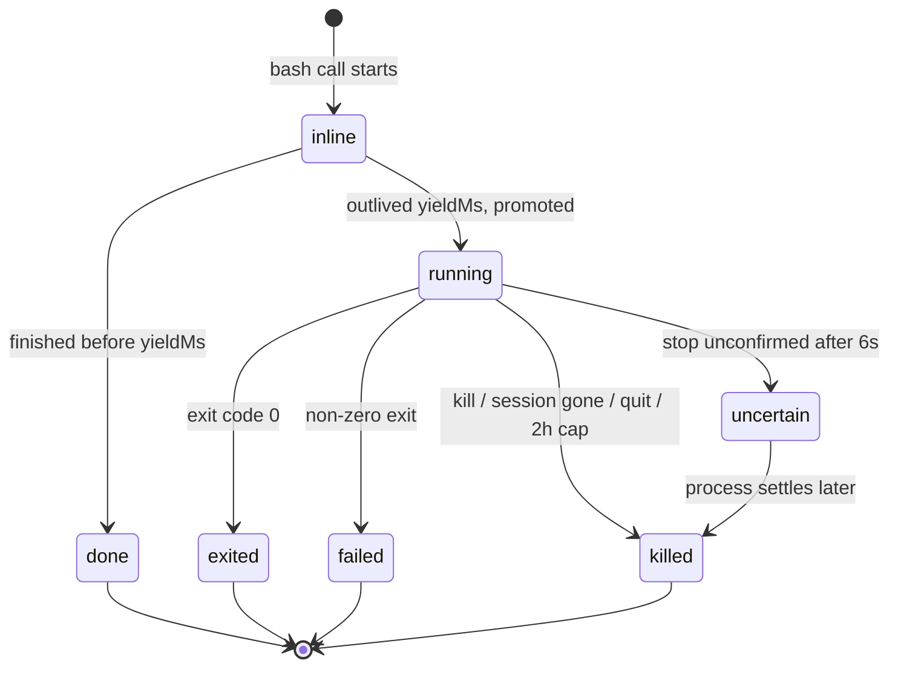

# Background processes

A `bash` command that outlives its wait is **no longer killed**. It keeps running, the tool call returns a process id, and the agent follows it with three new shell commands. This doc maps what that changes, who owns a running process, and what ends one.

The design argument and the rejected alternatives are in the [plan](../plans/active/background-shell-processes.md). This is the map of the code as it stands.

## The one rule

```
bash(command, yieldMs = 30s)
        │
        ├── finishes within yieldMs ──────────►  exit code + output      (unchanged)
        │
        ├── a message arrives for the session, and the command
        │   is still running 1 s later
        │        │
        │        ├── promoted ──►  bg_1, saying a message moved it (who wrote it)
        │        │
        │        └── promote fails ──► stays in the foreground, as if no message came
        │
        └── still running at yieldMs
                 │
                 ├── promote fails (cap, closing session, log) ──► run stopped, error text
                 │
                 └── promoted ──►  bg_1 + output so far + a log file path
                                        │
                                        └── agent uses `jobs` / `fg` / `kill`
```

A call that ends with `&` (`pnpm dev &`, `cd app && pnpm dev &`) goes to the background at once: the call returns as soon as the command has started its program, or failed before it could, and answers the way a shell announces a job, `[1] bg_1 4242`. The shell runs every statement in the foreground, so `&` anywhere else (`pnpm dev & echo $!`, a loop of `cmd &`, `(cmd &)`, and any `&` in a script the shell runs itself: `bash -c 'a & b'`, `sh -c 'cmd &'`, `eval`) is refused before anything runs rather than run in the foreground with nothing said ([`background-ampersand.ts`](../../packages/workspace/src/lib/background-ampersand.ts)). `disown` has nothing to act on, and `nohup cmd &` is a trailing `&` like any other.

The other trigger is a message for the session arriving mid-call: the person typing into the chat's working turn, the chat writing to its task, a task's finish waking the chat. The session machine ends the session's waits ([`lib/wait-interrupts.ts`](../../packages/workspace/src/lib/wait-interrupts.ts)), and a foreground command is one: it is promoted on the spot rather than holding the message until it ends, and the call returns so the message is heard at the next step ([`lib/chat/mid-turn.ts`](../../packages/workspace/src/lib/chat/mid-turn.ts)). A message never ends the command; it runs to completion, and one that ends after the turn wakes the session like any other. The 1 s grace lets a command about to finish answer for itself, an `fg` the same message ended most of all. A message that calls the work off ("stop") stops the turn instead, and its running command with it, like the Stop button.

## What the model sees change

| | Before | After |
|---|---|---|
| Wait parameter | `timeoutMs` — expiry kills the command | `yieldMs` — expiry hands it off |
| Tools | `bash` | `bash` (no new tools) |
| Commands | — | `jobs`, `fg`, `kill` |
| `bash` output | `exitCode`, `output` | adds `processId`, `pids`, `backgrounded`, `logFilePath`, `omittedBytes`, `logOmittedBytes`, `logWriteError`; `exitCode` becomes optional |

Management is **commands, not tools**, which buys two things a tool could not:

- **Composition.** `fg bg_1 | rg error` filters before the output is paid for in context. `fg bg_1 && pnpm test` works because `fg` exits with the process's own code.
- **No replay lie.** A tool result is re-rendered by `toModelOutput` every turn, so a tool that said "bg_1 running 5s" would keep saying it forever. Command stdout is captured once, so a `jobs` listing is frozen at the moment it ran.

## Lifecycle



`uncertain` is the honest state: the stop was issued, the tree did not confirm. If the process settles afterward, its **real exit code and last output are taken then** ([`background-processes.ts` `finish`](../../packages/workspace/src/lib/background-processes.ts)) rather than discarded.

## Where the code lives

```
tools/bash.ts ─────────────────────── starts the run, races yieldMs, promotes
        │                                       (packages/workspace/src/tools/bash.ts)
        ▼
lib/background-processes.ts ───────── the registry: ids, records, caps, reads, kills
        │   ├── background-output-buffer.ts   256 KB of pending output per process
        │   ├── bounded-log-writer.ts         16 MB log at .tool-output/bg_N.log
        │   ├── bounded-text.ts               head+tail bound on one read
        │   └── chunk-window.ts               eviction shared by the two buffers
        ▼
lib/shell-commands/output-sink.ts ─── AsyncLocalStorage sink; every chunk is
        │                              redacted here, before model and log
        ▼
lib/shell-commands/exec-shim.ts ───── spawns the real binary (detached on POSIX)
        │
        ▼
lib/subprocess-tree.ts ───────────── kills the whole tree, confirms it is gone
```

The agent-facing surface is one file: [`lib/shell-commands/background-jobs.ts`](../../packages/workspace/src/lib/shell-commands/background-jobs.ts), which defines `jobs`, `fg` and `kill` and is wired into the sandbox by `SESSION_COMMAND_DEFS` in [`create-bash-env.ts`](../../packages/workspace/src/lib/create-bash-env.ts).

## Ownership and what ends a process

The registry is keyed by **session**, not chat ([`recordsBySession`](../../packages/workspace/src/lib/background-processes.ts)). One chat holds several sessions, its own conversation and each task it started, all working in the same folder, so a chat-keyed registry would let one session read and kill another's work.

Ownership moves in one case: when the chat hands work to a task partway, `instrument task new --job bg_1` ([`task/fork.ts`](../../packages/workspace/src/lib/capabilities/task/fork.ts)) moves that command to the task's session under the same id (`handOverBackgroundProcesses`), so the task waits on it with `fg` instead of starting it a second time. The task works in the chat's folder, so the logs stay put.

| Trigger | Reaches | Where |
|---|---|---|
| `kill bg_1`, or the pid of a program it runs | one process | [`background-jobs.ts`](../../packages/workspace/src/lib/shell-commands/background-jobs.ts) |
| `kill <pid>` of a child inside a job | that one program; the job runs on | the same |
| Task stopped (the person's stop on its row or page, or `instrument task stop --all`) | that task's processes, handed-over jobs included; the chat's own Stop ends only its turn | `stopRunningProcesses`, from `session.stop` in [`rpc/routes/session.ts`](../../packages/workspace/src/rpc/routes/session.ts) and [`task/stop.ts`](../../packages/workspace/src/lib/capabilities/task/stop.ts) |
| Chat trashed | every process of the chat and its tasks | `killChatBackgroundProcesses` in [`lib/trash-chat.ts`](../../packages/workspace/src/lib/trash-chat.ts) |
| App quits | everything | [`create-workspace-actor.ts:349`](../../apps/studio/src/electron-main/lib/create-workspace-actor.ts#L349) |
| 2 hours old | that process | `ageTimer` in `promoteBackgroundProcess` |
| **Turn ends** | **nothing — deliberate** (one that ends afterward wakes the session, below) | — |

**The gaps this leaves**, in plain terms:

- The 2-hour cap is **absolute age, not idle time**. A dev server the user is actively using dies at two hours. The browser subsystem solved the same problem with idle-based reaping; this has not been changed to match.
- Nothing survives an app restart, and nothing tries to. A record describes a live child process; after a restart there is no process to describe.

## What the agent may stop

The agent may stop the processes it started, and nothing else on the person's computer. Looking stays allowed.

- **Each run knows its real pids.** Every program a `bash` call starts is watched as a process tree (`watchSubprocessTree`), and the run's listener (`withSubprocessTreeListener`, installed by `startBackgroundRun`) is told each one's pid as it starts and ends. In the bash worker the worker reports the tree with its exec's id and main hands it to that run's listener. On macOS and Linux each program is spawned detached, so it leads a process group of its own. `jobs -l` and `jobs -p` print the pids a job is running; on Linux that is bubblewrap's pid on the computer, since the program runs in a pid namespace of its own and sees other numbers for itself.
- **`kill` takes a job or a pid.** `bg_1`, `%1`, or any pid in the session's own trees: a program one of its jobs is running, a process in the group one of its programs leads, or one whose parents lead back to either. The app reads the computer's process table to answer that (`ps` on macOS, `/proc` on Linux, [`own-processes.ts`](../../packages/workspace/src/lib/own-processes.ts)), outside any sandbox. A program that has ended keeps its group, since what it left running there is the agent's too, but not its pid, which the system may give to an unrelated process; while it does, the old group is taken as gone. What a call that finished in the foreground started is kept too (the latest 256 pids per session), so a program it left behind in its group can still be stopped. On Windows there is no table, and only a program a job is running counts. Anything else is refused: "kill: 611 is not a process this conversation started, so it can't be stopped from here."
- **Signals.** No signal, TERM, INT or KILL stop the process with the escalation and confirmation below; a job's own program stops the job, so `jobs` says so. Any other signal (`-HUP`, `-USR1`) goes straight to the pid, or to each program's group for a job, as a shell signals `%1`. On Linux a signal for bubblewrap's pid, the stop's first SIGTERM included, goes to the group of the sandbox's first process, which leads the program's session inside it (`programGroup` in [`subprocess-tree.ts`](../../packages/workspace/src/lib/subprocess-tree.ts)): bubblewrap passes no signal on, and a signal that ends it takes the program down with SIGKILL, so the program would never get to shut down or reload. `-0` answers for any pid, the person's included, since whether a process is there is a question about the computer rather than a step that changes it. `kill -l` lists signals as bash does. `xargs kill` runs the builtin xargs, which runs this `kill` (`xargsRunsKill` in `native-text.ts`), so `lsof -ti :3000 | xargs kill` frees a port the agent's own server holds.
- **The sandbox draws the same line for programs.** On macOS the Seatbelt profile denies signals outside the command's own sandbox, so `/bin/kill`, `pkill` and `killall` reach only what that same command started, and get EPERM for anything else; `signalRefusalNote` tells the agent to use the shell's `kill`. On Linux each command's pid namespace already confines a program to what its own command started. On Windows MXC does too, measured on Windows 11 (build 26200) through its launcher: from inside the container `Get-Process` and `Process.GetProcessById` find no process outside it, `taskkill /pid` hangs without ending it, and a program still ends its own child by handle. Without MXC nothing confines a program there. Looking is not confined: the shell runs `ps` and `top` outside the sandbox with options that only read, so on macOS and Linux they list every process the person's account can see ([native-and-builtin-commands.md](native-and-builtin-commands.md#calls-that-skip-the-os-sandbox)). Seatbelt refuses them when a program or script starts them, since they run as root, and the note says to run them as a shell command. On Windows the shell runs `tasklist` outside MXC the same way, so it lists every process, while `Get-Process` and any other program under MXC see only their own container's, and `taskkill` stays held.

## Caps

| Bound | Value | Why |
|---|---|---|
| Running per chat | 8 | Counted across the chat and its tasks; refusing the ninth names the ones the asking session owns and counts the rest |
| Pending output per process | 256 KB | Held in memory between reads |
| Process log | 16 MB | On disk at `.tool-output/bg_N.log`, opened following no link (`own-file.ts`) |
| One `fg` wait | the call's remaining `yieldMs`, 10 min ceiling | A wait that outlived its call would promote the call itself, answering with a second id instead of output. An explicit `--timeout` can only lower it. A message arriving for the session ends the wait early (`lib/wait-interrupts.ts`), since a steer is heard at the next step and a step spent waiting would hold it for the whole window |
| `yieldMs` | 250 ms – 10 min, default 30 s | Tool-call timeout is `yieldMs + 30 s` so promotion always wins |
| Kill escalation | SIGTERM → 1 s → SIGKILL → 4 s | Then `uncertain` |
| Finished records kept | 32 per session | A late poll still finds its exit code |

## Who stopped it

A stop carries who asked for it (`stoppedBy`: the agent's own `kill`, the user's, or the conversation's `instrument task stop`), and `fg` and `jobs` say so rather than printing the interpreter's abort code. A stop the agent did not make is a decision it must not undo, and the text tells it not to start the process again unless asked; "finished with exit code 124" read as the command failing on its own.

## When one ends after the turn

A turn that leaves a command running can end with the agent saying it is waiting on it, as when `ls ~/Documents` sits behind the macOS privacy prompt until the person answers it. When that command ends on its own, the session that owns it is woken, the way a task finishing wakes its chat ([`lib/chat/job-wake.ts`](../../packages/workspace/src/lib/chat/job-wake.ts)):

- The registry publishes `backgroundProcess.settled` when a process ends without anyone asking: an exit, a failure, or the 2-hour cap. A stop somebody asked for publishes nothing: the agent's own `kill`, the user's stop, the conversation's `instrument task stop`, and the app's quit, which stops everything as the user's.
- Each record carries whether the agent has been told how it ended (`reported`). `fg`, `jobs`, `kill` and the wake itself set it, and the wake sets it before the note is sent, so a process is reported once and the turn its wake starts cannot wake the session again.
- The wake waits 1.5 s, so processes ending together arrive as one note, then wakes the session only if it has no turn running. A session with a turn running hears of it through `fg` and `jobs`; whatever that turn never read wakes the session once its `session.done` arrives.
- A session whose last turn the user (or, for a task, the chat) stopped is not woken: the endings are marked told, and the next turn's `data-backgroundProcesses` note says they are gone.
- The note is a `data-jobEvent` part on a text-less user message in the owning session, written through `wakeSessionForJobs` in [`wake.ts`](../../packages/workspace/src/lib/chat/wake.ts): the chat's own session, or a task's, whose finish then wakes the chat as usual. The model reads it as [`jobEventModelNote`](../../packages/workspace/src/lib/job-event-model-text.ts): the id, the command, how it ended and after how long, `fg bg_N` and the log path to read its output, and to finish what the user was waiting on.
- The person does not see the note outside developer mode, where it is a context card: the reply that follows says what came of the command, the same reason a task's finish is hidden in the chat.

A server that never exits wakes nothing until the age cap stops it.

## Two Unix metaphors we sit on

- **`kill`** takes a pid, as a shell's does, and `bg_1` or `%1` besides; a pid outside the session's own trees is refused (above).
- **`wait`** is a `just-bash` interpreter builtin that no custom command can shadow, and it exits **0 with empty output** — which reads as "the process finished and wrote nothing", the one wrong answer here that looks right. A transform in `create-bash-env.ts` rewrites `wait` to `fg` in the AST, with a first argument that has it answer as `wait`, so the agent's strongest prior cannot produce the builtin's answer. `wait <pid>` waits on the job that started that pid.

## What the user sees

A task page's header carries a still pill beside the task's title and menu ("2 jobs running", [`task-background-processes.tsx`](../../apps/studio/src/client/components/task/task-background-processes.tsx)), drawn only while something the agent started is still running. It opens a popover headed "Still running" that lists each command under the agent's label for it, with how long it has run and a stop for that one, plus a Stop (or Stop all) for every one, and says they end when the app quits or after two hours. The pill and the transcript both read `useTaskBackgroundProcesses`, so the transcript also marks a step whose command is still running and stops it from there; a chat's task list stops a whole task. The wording keeps the word "process" out of sight, since the audience did not ask for a server and does not know they have one. A chat says the same for itself and all its tasks: once nothing is at work or waiting on the user, the line under its title adds how many jobs are running after a middle dot, still and muted since a job is not the agent at work, and its tasks popover lists them under Jobs with the task that started each ([`chat-status-line.tsx`](../../apps/studio/src/client/components/window/chat-status-line.tsx), [`chat-activity.tsx`](../../apps/studio/src/client/components/window/chat-activity.tsx)).

Quitting stops every one of them, so the quit asks first whenever any is running and names each by its label, or by the start of its command when the agent wrote none ([`quit-prompt.ts`](../../apps/studio/src/electron-main/lib/quit-prompt.ts)). On macOS closing the last window is not a quit: the app stays in the Dock and they keep running.

One other renderer change: a promoted command has no exit code yet, and treating a missing code as non-zero painted every still-running command as a failure — fixed in [`bash-exit-status.ts`](../../apps/studio/src/client/components/message-part/bash-exit-status.ts).

**What is still missing:** the app itself shows nothing when the two-hour cap fires; the word comes only from the agent its ending wakes. And nothing outside a task's own page counts them, so a task you are not looking at can hold a running process invisibly.

## Does ordinary `bash` behave worse?

The honest list of what changed for a command that never gets promoted:

- **Every** run now allocates an output buffer and a start timestamp, because any run may be promoted. One extra clock read; no I/O until promotion.
- **Every** streamed chunk passes through redaction at the sink rather than only the final output being filtered. The redaction is bounded to stay linear in line length.
- On POSIX, shims spawn `detached` so a kill can reach the whole process group. This does **not** create crash-orphans that did not exist before: descendants already survived a parent SIGKILL either way, and execa's own cleanup only ever killed the direct child.
- `pnpm dev` and `pnpm start` are **no longer refused**. They were refused only because nothing could host a long-running command; now something can.
